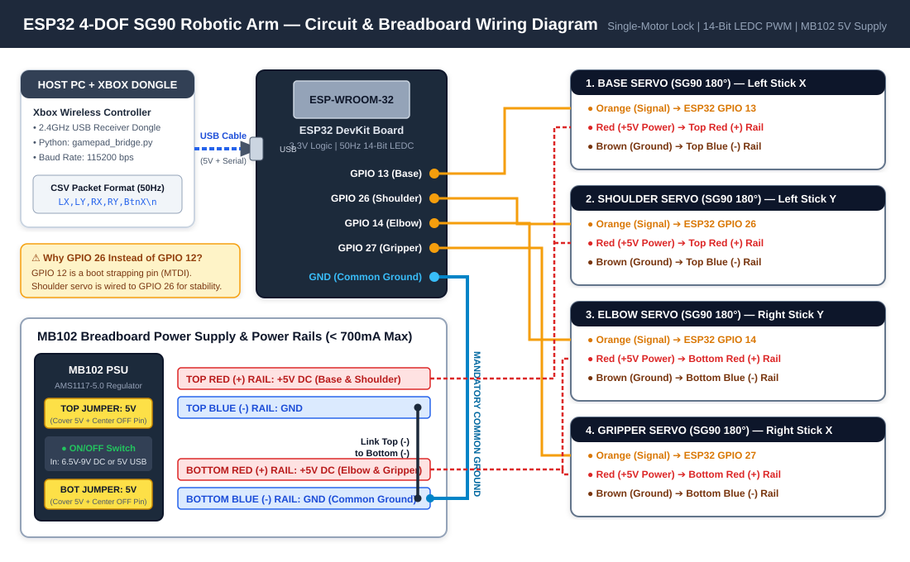

# ESP32 4-DOF Robotic Arm Controller (Xbox 2.4GHz PC Bridge)



Control a 4-DOF SG90 acrylic robotic arm using an Xbox-style wireless controller (2.4GHz USB PC dongle), a Python serial bridge, and an ESP32. 

The ESP32 firmware uses a **Single-Motor-At-A-Time Power Lock** and **14-bit Hardware LEDC PWM Auto-Muting** (`0` duty cycle after 250ms idle). This prevents voltage brownouts, sudden 90-degree servo snaps, and idle gear grinding when running on a 700mA MB102 breadboard power supply.

---

## Repository Structure

```text
esp32-xbox-4dof-robot-arm/
├── README.md
├── LICENSE
├── .gitignore
├── docs/
│   ├── circuit_diagram.svg
│   └── circuit_diagram.pdf
├── firmware/
│   └── esp32_arm_controller/
│       └── esp32_arm_controller.ino
├── pc_bridge/
│   ├── gamepad_bridge.py
│   └── requirements.txt
└── hardware/
    └── kicad/
        ├── esp32_robo_arm.kicad_pro
        ├── esp32_robo_arm.kicad_sch
        └── esp32_robo_arm.net
```

---

## Bill of Materials (BOM)

### Required Components
| Component | Qty | Reference Link (Privacy-Cleaned) | Notes |
| :--- | :---: | :--- | :--- |
| **4-DOF Acrylic Robot Arm Structure** | 1 | [Amazon India (B0H21XDFTL)](https://www.amazon.in/dp/B0H21XDFTL) | Unassembled laser-cut acrylic frame + M3 screw kit |
| **SG90 9g Micro Servo Motor (180°)** | 4 | [Amazon India (B0DGW59SV6)](https://www.amazon.in/dp/B0DGW59SV6) | 4.8V–6.0V, 1.3 kg/cm stall torque, positional 180° |
| **MB102 Breadboard Power Supply** | 1 | [Robocraze MB102 3.3V/5V](https://robocraze.com/products/breadboard-power-supply-3-3v-5v) | Set both rail jumper caps to **5V** (`5V` + center `OFF` pin) |
| **ESP32 Development Board** | 1 | Standard ESP-WROOM-32 | Powered separately via PC USB cable |
| **830-Point / 400-Point Breadboard** | 1 | Standard MB102 Breadboard | For power distribution rails |
| **Xbox-Style Controller + USB Dongle** | 1 | 2.4GHz XInput PC Receiver | Connected to host PC running `gamepad_bridge.py` |
| **6.5V–9V DC Adapter (or 5V USB)** | 1 | 1A+ DC Wall Adapter | Powers the MB102 module |

### Recommended Upgrades (Optional)
* **PCA9685 16-Channel 12-Bit I2C Servo Driver:** Offloads PWM generation and provides a dedicated screw terminal for 5V 3A+ power supplies.
* **470µF – 1000µF Electrolytic Capacitor (10V+):** Placed across the breadboard `+` and `-` rails to absorb servo start-up current spikes.
* **5V 3A Switching Power Supply:** Required if you modify the firmware to move all 4 servos simultaneously under heavy load.

---

## Power Supply Specifications (MB102 3.3V/5V Module)

This project uses the **MB102 Breadboard Power Supply Module** to power the four SG90 servos:
* **Regulator IC:** Onboard `AMS1117-5.0` linear voltage regulator.
* **Maximum Current Output:** **< 700 mA peak** (~350 mA–500 mA continuous before thermal shutdown).
* **Servo Current Demand:** A single SG90 draws **10–15 mA** idle, **150–250 mA** moving lightly, **350–500 mA** during startup spikes, and **650–750 mA** if stalled.
* **Why Single-Motor Software Lock is Used:** Moving 2 to 4 servos at the same instant draws over **1,000 mA**, causing the MB102's 5V rail to collapse and reset the servos (violent snapping). Our firmware strictly moves **one joint at a time** and mutes the PWM signal on the other three joints so total draw stays safely inside the MB102's 700 mA ceiling.

---

## ⚠️ Critical Wiring & Power Warnings

1. **MANDATORY COMMON GROUND:** You **must** connect a jumper wire from an **ESP32 `GND` pin** to the **breadboard Blue (`-`) ground rail** (and link the top and bottom Blue `-` rails together). Without a shared ground reference, the 3.3V PWM signals from the ESP32 will float and cause wild servo jitter.
2. **NEVER POWER 4 SERVOS FROM THE ESP32 3V3 PIN:** Always power the servo Red (`+5V`) wires from the external 5V breadboard rail.
3. **MB102 5V JUMPER CAP SETTING:** On both wings of the MB102, place the yellow jumper cap across the **`5V` pin and the center (`OFF`) pin**, leaving the `3.3V` pin bare.
4. **AVOID 12V ADAPTERS ON THE MB102:** Feeding 12V into the MB102 barrel jack forces the linear regulator to burn off 7V as heat, triggering thermal shutdown in seconds. Use a **6.5V–9V DC adapter** or the **5V USB input**.
5. **DO NOT USE ESP32 GPIO 12:** `GPIO 12` is a boot strapping pin (MTDI) that controls flash voltage on startup. This repo uses **`GPIO 26`** for the Shoulder joint instead.
6. **CHECK BREADBOARD MID-RAIL SPLITS:** Full-size 830-point breadboards often break the Red (`+`) and Blue (`-`) rails in the middle. Plug all servo power wires into the half closest to the MB102, or bridge the center gap with jumper wires.
7. **WIRE WITH POWER OFF:** Always keep the MB102 latching switch **OFF** (popped up) while plugging or unplugging jumper wires.

---

## Pinout & Controller Mapping

| Joint | Controller Input | ESP32 Signal Pin (Orange) | Servo Power (Red) | Servo Ground (Brown) |
| :--- | :--- | :---: | :--- | :--- |
| **Base** | Left Stick (Left / Right) | `GPIO 13` | Top `+5V` Rail | Breadboard `-` (GND) Rail |
| **Shoulder** | Left Stick (Up / Down) | `GPIO 26` | Top `+5V` Rail | Breadboard `-` (GND) Rail |
| **Elbow** | Right Stick (Up / Down) | `GPIO 14` | Bottom `+5V` Rail | Breadboard `-` (GND) Rail |
| **Gripper** | Right Stick (Left / Right)| `GPIO 27` | Bottom `+5V` Rail | Breadboard `-` (GND) Rail |
| **Reset All**| `X` Button (Sequential) | — | — | — |

---

## Quick Start

1. **Flash ESP32 Firmware:** Open `firmware/esp32_arm_controller/esp32_arm_controller.ino` in the Arduino IDE, select your ESP32 board, and upload. **Close the Arduino Serial Monitor** after uploading.
2. **Power Up Breadboard:** Verify wiring against `docs/circuit_diagram.pdf`, plug in the MB102 power supply, and press the latching switch ON.
3. **Run PC Bridge:**
   ```bash
   cd pc_bridge
   pip install -r requirements.txt
   python gamepad_bridge.py
   ```
